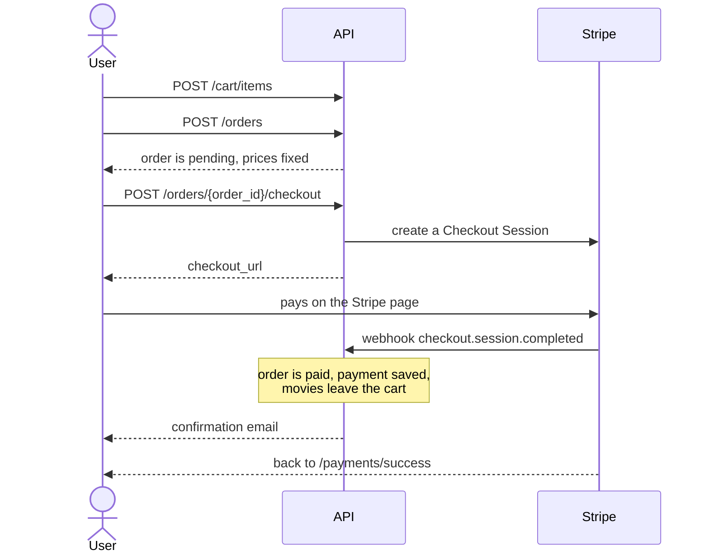

# Online Cinema

[](https://github.com/SerhiiAm/online-cinema/actions/workflows/ci.yml)


Async REST API for an online cinema: users browse a movie catalog, put movies
in a cart, place an order and pay for it on a Stripe Checkout page.

## Features

- **Accounts:** registration with email activation, JWT login, password change
  and reset by email.
- **Roles:** `user`, `moderator` (manages the catalog) and `admin` (manages
  users, sees all orders and payments).
- **Movie catalog:** pages, search, filters by year, rating, genre and star,
  sorting by year, price, rating or popularity.
- **Cart and orders:** prices are fixed when the order is created, movies you
  have already bought are left out.
- **Stripe payments (PLN):** Checkout page, signed webhook, confirmation email.
- **History:** your own orders and payments; admins see everyone's, with
  filters by user, status and dates.
- **Background jobs:** emails and hourly/daily cleanup of expired tokens with
  Celery.

## How a purchase works



## Highlights

- **Stolen refresh tokens are detected.** A refresh token works only once; if
  a used one comes again, all sessions of the user are logged out. The
  database keeps only the ids of refresh tokens and only a hash of password
  reset tokens, so a leak gives no working tokens of either kind.
- **No race conditions on money.** Row locks make a double click on "pay" open
  one Stripe page, and a cancel first closes the open payment page, so a
  canceled order can never be paid.
- **Only Stripe can mark an order paid.** There is no endpoint for it; the
  webhook is checked by its signature, and the same event sent twice changes
  nothing.
- **Prices can't change under the buyer.** The order keeps its prices, and they
  are checked again before the payment page opens.
- **Purchase history is never lost.** A movie that is in any order can't be
  deleted.
- **Bad input gives 422, not 500**: huge ids, `NaN`, the NUL character and
  other values PostgreSQL would reject.
- **About 580 tests, 99% coverage**, on a real PostgreSQL test database;
  Stripe and Celery are mocked, and any real Stripe call fails the test.
  CI runs flake8 and the tests on every push.

## Tech stack

| Area | Tools |
|---|---|
| API | Python 3.13, FastAPI, Pydantic |
| Database | PostgreSQL 16, SQLAlchemy 2.0 (async, asyncpg), Alembic |
| Auth | JWT (PyJWT), Argon2 password hashes (pwdlib) |
| Background jobs | Celery, Redis, Mailpit for local emails |
| Payments | Stripe Checkout + webhooks |
| Tooling | Docker Compose, Poetry, pytest, pytest-cov, flake8, GitHub Actions |

## Quick start

```bash
git clone https://github.com/SerhiiAm/online-cinema.git
cd online-cinema
cp .env.example .env
docker compose up --build -d
docker compose exec app alembic upgrade head
```

Before the first start, set `JWT_SECRET_KEY` in `.env` to a long random string, e.g.
the output of `python -c "import secrets; print(secrets.token_urlsafe(32))"`.
To pay for orders, also set the Stripe keys (see
[Trying payments locally](#trying-payments-locally)).

- API docs (Swagger): http://localhost:8000/docs
- Health check: http://localhost:8000/health
- Mailpit (local inbox for outgoing emails): http://localhost:8025
- **Rules of every endpoint: [docs/api.md](docs/api.md)**

To get an admin, register an account and run
`docker compose exec app python -m app.scripts.make_admin admin@example.com`.

## Services

| Service | Purpose |
|---|---|
| `app` | FastAPI application |
| `db` | PostgreSQL |
| `redis` | Message broker for Celery |
| `celery_worker` | Runs background tasks (sending emails, deleting expired tokens) |
| `celery_beat` | Puts periodic tasks into the queue on schedule |
| `mailpit` | Fake SMTP server that catches all outgoing emails locally |

Unlike `app`, the worker and beat do not reload on code changes. Restart them
after editing tasks or the schedule:

```bash
docker compose restart celery_worker celery_beat
docker compose logs -f celery_worker celery_beat
```

## Running tests

Tests need a running PostgreSQL. They create a separate `<POSTGRES_DB>_test`
database on every run, so your development data is never touched.
Redis and Stripe are not needed: their calls are mocked.

```bash
# inside Docker
docker compose exec app pytest -v

# or locally, with a coverage report
docker compose up -d db
poetry run pytest --cov=app --cov-report=term-missing
```

## Local development (without Docker for the app)

```bash
poetry install
docker compose up -d db redis mailpit
poetry run alembic upgrade head
poetry run uvicorn app.main:app --reload

# in a second terminal
poetry run celery -A app.core.celery_app worker --loglevel=info --pool=solo

# in a third terminal (only needed for periodic tasks)
poetry run celery -A app.core.celery_app beat --loglevel=info
```

`--pool=solo` is needed on Windows, where Celery's default pool does not work.
On Windows also keep `POSTGRES_HOST=127.0.0.1` in `.env`: with `localhost`
every database connection waits about 2 seconds for an IPv6 attempt first.

## Trying payments locally

You need a Stripe account (a free sandbox is enough) and the
[Stripe CLI](https://docs.stripe.com/stripe-cli).

1. Copy the secret key (`sk_test_...`) from the Stripe Dashboard
   (Developers → API keys) into `STRIPE_SECRET_KEY` in `.env`.
2. Log in and forward Stripe's events to the local API, in a separate terminal
   that stays open:

   ```bash
   stripe login
   stripe listen --events checkout.session.completed,checkout.session.async_payment_succeeded --forward-to localhost:8000/payments/webhook
   ```

3. Copy the `whsec_...` secret printed by `stripe listen` into
   `STRIPE_WEBHOOK_SECRET` in `.env` and run `docker compose up -d`, so the
   containers read the new values (`restart` doesn't re-read `.env`).
4. Add a movie to the cart, `POST /orders`, `POST /orders/{order_id}/checkout`,
   open `checkout_url` and pay with a test card:

   | Card | Result |
   |---|---|
   | `4242 4242 4242 4242` | the payment succeeds |
   | `4000 0000 0000 0002` | the card is declined, the order stays `pending` |

   Any future expiry date and any CVC work.

`stripe listen` shows each event it forwards and the answer of
`/payments/webhook` (`[200]`). The confirmation email arrives in Mailpit.

## Project structure

```
app/
  core/       settings, database, security, validators and the Stripe client
  models/     SQLAlchemy models
  schemas/    Pydantic request and response schemas
  crud/       database operations
  routers/    API endpoints
  tasks/      Celery tasks
  scripts/    server-side admin commands (make_admin)
alembic/      database migrations
docs/         API reference
tests/        pytest tests (mirrors the app/ structure)
```
